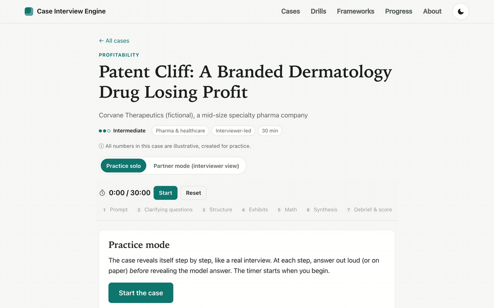
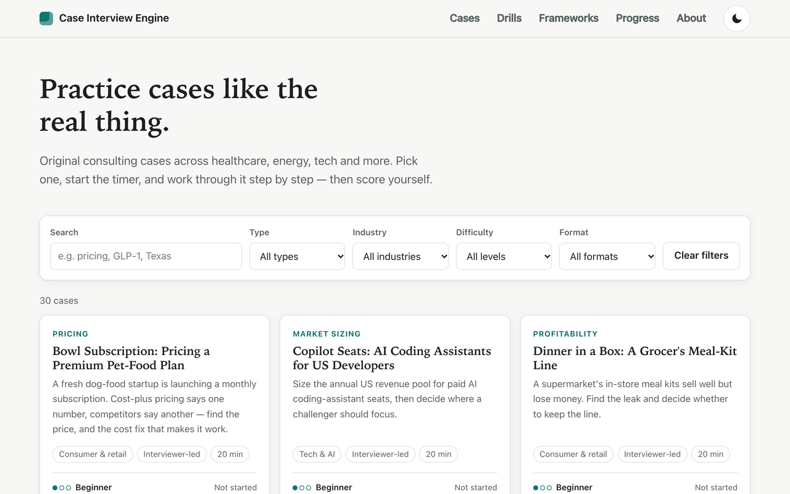
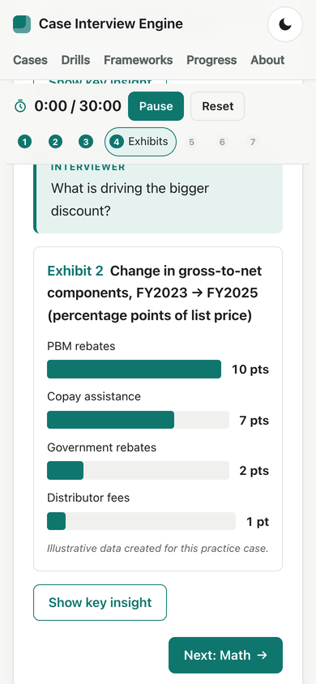

# Case Interview Engine

**A free library of 50 original consulting case interviews, with a step-by-step practice mode, a partner mode for practicing with a friend, and math that is verified by automated tests.**

### ▶ [Try it live: lucamurri.github.io/case-interview-engine](https://lucamurri.github.io/case-interview-engine/)

No sign-up, no paywall, no tracking. Works on your phone.



---

## Why I built it

I'm [Luca Murri](https://www.linkedin.com/in/lucamurri), a Master in Management candidate at Chicago Booth (Class of 2027), recruiting for management consulting after a background in pharma marketing.

While preparing, I kept running into the same problems. Good practice cases are scattered across casebooks and paywalled sites. It's hard to practice realistically on your own. And it's easy to find math errors in published cases. I wanted a tool that would:

- **feel like a real interview:** information is revealed only when you'd get it, and there's a timer;
- **be trustworthy:** every number in every case is recalculated by an automated test before the site is published;
- **be free for everyone:** classmates and other candidates, on any device, with no account.

The cases lean toward the industries I know and care about: **pharma & healthcare, energy, and tech & AI**.

## Features

| | |
|---|---|
| **50 original cases** | Profitability (10), market sizing (9), market entry (8), pricing (8), operations (8), M&A / investment (7). Pharma & healthcare (10), consumer (9), tech & AI (8), energy (7), plus financial services, industrials, sports, education, nonprofits and more. Beginner to advanced; interviewer-led (McKinsey-style) and candidate-led (BCG/Bain-style). |
| **Case library** | Search and filter by industry, type, difficulty and format. |
| **Practice mode** | Step-by-step reveal: prompt → clarifying questions (answered only if you ask) → structure → exhibits → math → synthesis → debrief, with a timer. |
| **Partner mode** | An interviewer view for practicing with a friend: what to read aloud, what to reveal only if asked, the questions to ask in order, and what a good answer looks like. Exhibits can be shown full-screen to the candidate. |
| **Self-score rubric** | Score structure, math, business judgment, synthesis and communication (1–5). Progress is saved in your browser; export it as JSON or CSV. |
| **Mental math drills** | Randomized percentages, growth rates, break-evens and big-number multiplication, in 10-question rounds or 2-minute sprints. |
| **Top 10 case frameworks** | The ten questions behind most cases (profits, growth, cost cutting, market entry, launch, pricing, investment, acquisition, competitive response, process), each with an original issue tree and a coach's note, focused on *adapting* a structure rather than reciting it. |
| **Accessible and mobile-first** | Dark mode, keyboard navigation, screen-reader labels, WCAG AA contrast. Audited with axe-core with zero issues. |

Every case includes a client prompt, clarifying information, a MECE issue tree, 1–3 exhibits, a step-by-step math walkthrough, an answer-first synthesis, common mistakes, what top candidates do differently, and a creative brainstorm question with a model answer.

<p align="center">
  
  &nbsp;
  
</p>

## How quality is enforced

Three automated checks run on every change. If any of them fails, the site is not published.

- **Math test:** recalculates **1,223 numbers** across the 50 cases from their inputs. Case text never types a result by hand. It refers to checked calculations by name (for example `{{payback_toll}}`), so the walkthrough, the exhibits and the answer can't drift apart. A typed result like "= $19.6M" fails the test.
- **Content linter:** fails if any case is missing a required section, a clarifying Q&A or an exhibit label, or if any field uses a value outside the allowed list.
- **Drills test:** generates **5,000 questions** and checks each answer against an independent recalculation from the numbers shown on screen.
- **Link check:** fails on any broken internal link.

All cases are original and all clients are fictional. Numbers are realistic but **illustrative**, and labeled as such on every case and exhibit.

## Contribute a case

Cases are plain text files. You can add one without touching any code.

1. Copy [`content/cases/_template.md`](content/cases/_template.md) to `content/cases/your-case-id.md`.
2. Fill in the top section (between the `---` lines) with the details, the **inputs** and the **calculations**:

   ```yaml
   id: your-case-id
   title: "Hook: What the Case Is About"
   industry: pharma-healthcare     # pharma-healthcare | energy | consumer-retail | tech-ai | other
   type: profitability             # market-sizing | profitability | market-entry | pricing | m-and-a | operations
   difficulty: intermediate        # beginner | intermediate | advanced
   format: interviewer-led         # interviewer-led | candidate-led
   time_minutes: 30

   inputs:
     units: { value: 2.0, unit: "million", label: "Units sold per year" }
     price: { value: 50,  unit: "$",       label: "Price per unit" }

   calculations:
     - { id: revenue, label: "Annual revenue", formula: "units * price", expected: 100, unit: "$M" }
   ```

3. Write the sections below it in Markdown (`## Prompt`, `## Clarifying information`, `## Structure`, `## Math walkthrough`, `## Synthesis`, …), using `{{revenue}}` wherever a calculated number appears.
4. Run `npm test`. It tells you in plain English if anything is missing or a number is wrong.
5. Open a pull request. Or, if you'd rather not write code, [suggest a case idea](https://github.com/lucamurri/case-interview-engine/issues/new/choose) using the short form.

Please only contribute original material: nothing copied or adapted from school casebooks, firm websites or books.

## Tech stack

Deliberately simple, so it costs nothing to host and stays easy to maintain:

- **Plain HTML, CSS and JavaScript.** No framework, no third-party scripts, no cookies or analytics.
- **A small Node.js build script** turns the Markdown case files into the site. Its only dependencies are [`js-yaml`](https://github.com/nodeca/js-yaml) and [`marked`](https://github.com/markedjs/marked), and they run only at build time.
- **A purpose-built safe calculator** evaluates case formulas without `eval()`.
- **GitHub Actions** runs all checks and deploys to **GitHub Pages** on every push to `main`. Both are free for public repositories.

### Run it locally

Requires [Node.js](https://nodejs.org/) 20 or newer.

```bash
git clone https://github.com/lucamurri/case-interview-engine.git
cd case-interview-engine
npm install
npm test                 # content linter, math test, drills test
npm run dev              # build, then open http://localhost:8080
npm run preview -- gene-therapy-pricing   # read one case as plain text
```

```
content/cases/        one Markdown file per case (what you edit)
content/frameworks/   the Top 10 frameworks guides
src/                  pages, styles and browser code
scripts/              build, tests, link checker, local server
.github/workflows/    test-and-deploy pipeline
```

## License

- **Code:** [MIT](LICENSE)
- **Case and framework content:** [CC BY-NC 4.0](content/LICENSE). Free to share and adapt for non-commercial use, with credit.

All companies are fictional, and all numbers are illustrative.
